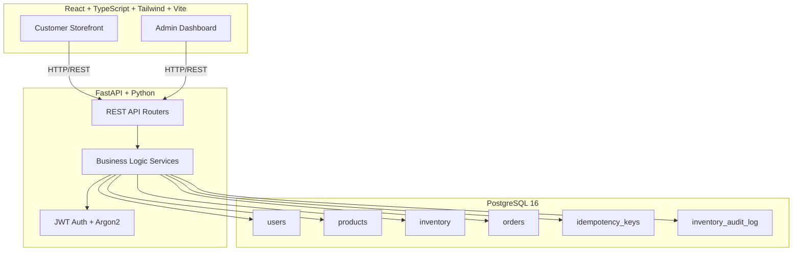

# VAULTCORE Architecture

## Overview
VAULTCORE is a modular monolith full-stack e-commerce platform with transaction-safe order processing.

## Architecture Diagram

## Data Flow

### Checkout (Transaction-Safe)
1. Customer clicks "Place order" with an idempotency key.
2. Backend checks idempotency key (fast path, no locks).
3. Backend locks product and inventory rows in ascending ID order (`SELECT ... FOR UPDATE`).
4. Backend re-checks idempotency key inside the transaction.
5. Backend validates stock and computes total from database prices (not frontend).
6. Backend decrements inventory with conditional `UPDATE ... WHERE quantity >= n`.
7. Backend writes order, order items, idempotency key record, clears cart — all in one transaction.
8. If unique constraint on `(user_id, key)` is violated by a concurrent request, return the existing order.

## Modules

| Module | Responsibility |
|--------|---------------|
| Auth | Registration, login, JWT, RBAC |
| Products | Catalog, search, admin CRUD |
| Cart | Add/update/remove items, backend price validation |
| Inventory | Stock tracking, low-stock alerts, audit log |
| Orders | Checkout, order tracking, admin status updates |
| Admin | Dashboard stats, user/product/order management |
